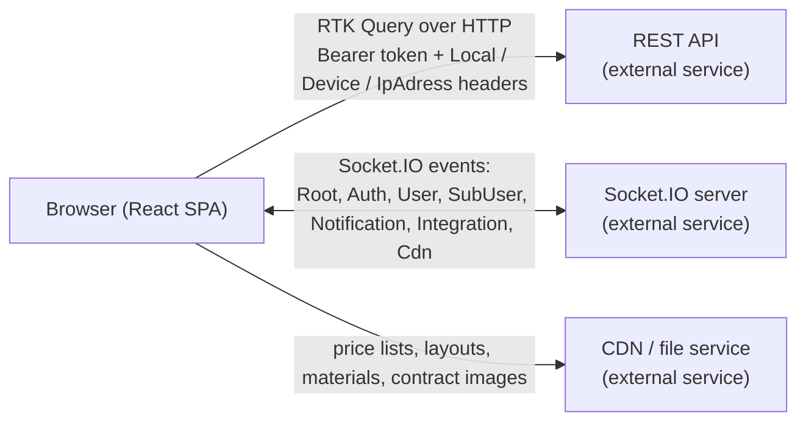

# Master V — Real Estate Intelligence Web App

> A bilingual (English / Arabic, RTL-aware) React single-page app for searching real estate developer projects, comparing payment plans, and managing broker sales commissions, with live updates over WebSockets.


_The Data screen (from `public/Img/Screenshots/`). Residential/Commercial sections, city/type/bedroom/finishing/delivery/payment-plan filters, and a project list with developer logos, starting price and delivery._

- **Production URL (referenced in the code):** <https://masterv.net> — access requires an account.
- **Scope of this repository:** the **frontend only**. The REST API, WebSocket server and CDN it talks to are separate services and are **not** in this repository.

---

## Table of contents

1. [Overview](#1-overview)
2. [Product purpose and target users](#2-product-purpose-and-target-users)
3. [Features and implementation status](#3-features-and-implementation-status)
4. [Technology stack](#4-technology-stack)
5. [Architecture overview](#5-architecture-overview)
6. [Project structure](#6-project-structure)
7. [Main user flows and core business logic](#7-main-user-flows-and-core-business-logic)
8. [Setup and installation](#8-setup-and-installation)
9. [Configuration (environment variables)](#9-configuration-environment-variables)
10. [Local development](#10-local-development)
11. [Testing and quality checks](#11-testing-and-quality-checks)
12. [Deployment](#12-deployment)
13. [Current status and known limitations](#13-current-status-and-known-limitations)
14. [Roadmap](#14-roadmap)
15. [Engineering decisions and trade-offs](#15-engineering-decisions-and-trade-offs)
16. [What makes this project technically interesting](#16-what-makes-this-project-technically-interesting)
17. [Ownership and license](#17-ownership-and-license)

---

## 1. Overview

Master V is the web client of a real estate intelligence product. It gives sales professionals one place to:

- search and filter real estate developer projects (compounds, phases, unit types) by city, area, type, bedrooms, finishing, delivery date, budget, down payment and installment years;
- open a project and see its phases, payment plans, price lists, layouts, materials and location;
- contact developers' sales contacts and share project information over WhatsApp;
- track and calculate commissions on closed deals (Gold accounts);
- manage a team of sub-users and their city access (Company accounts).

The problem it addresses: project information, price lists and payment plans from many developers are scattered across PDFs, chats and spreadsheets. This app puts them behind a consistent, filterable interface with role-based access.

## 2. Product purpose and target users

The user roles are defined in `src/Hooks/useValidateRole/index.jsx` and the routing in `src/App.jsx`.

| Role (`RoleKey`) | Who it is for (inferred from role and job-title data in the code) | What they can access |
| --- | --- | --- |
| `Personal` | Individual broker / sales agent | Data search, project details, Settings |
| `Gold` | Personal account with the commission tracker | Everything in `Personal` + `/Sales` |
| `Company` | Brokerage company owner | Data search (limited to the cities/areas selected on the account), Settings, `/Dashboard` (sub-user and company management) |
| `SubUser` | Employee of a company (job titles in `src/Lang/en.js`: Junior Sales, Senior Sales, Team Leader, Sales Supervisor) | Data search limited to the cities assigned by the company |

The reference data in the code (cities such as New Cairo, New Capital and North Coast in `src/Utility/Helper.js`; prices in "LE"; a `+2` default phone prefix; Egyptian developer logos) indicates the Egyptian market. The product positioning above is an interpretation of the code, not a statement from product documentation.

## 3. Features and implementation status

Status legend: **Implemented** (working code path present), **Partial** (UI or logic exists but incomplete), **Planned** (see [`ROADMAP.md`](ROADMAP.md)).

### Discover and compare projects

| Feature | Status | Where |
| --- | --- | --- |
| Residential / Commercial sections and per-city search | Implemented | `src/Pages/Data`, `src/Redux/Slice/Data.js` |
| Filter sidebar: cities, types, bedrooms, built-up area, finishing, delivery range, budget (installment or cash price), payment plan (down payment, years), compound, developer, extra benefits, consultants | Implemented | `src/Components/Data/Sidebar/FilterSideBar` |
| Project list with start price, delivery and developer logo | Implemented | `src/Components/Data/_DataContent` |
| Project detail panel: phases, payment plans, price list, contacts | Implemented | `src/Components/Data/_ItemInfo` |
| Price-list calculations per unit type (discounted price, down payment, monthly installment from payment-plan bulks) | Implemented | `src/Components/Data/_ItemInfo/PriceList`, `src/Utility/Helper.js` |
| Material, layout and price-list file viewers (files served by the CDN) | Implemented | `src/Components/Data/View`, `src/Common/FileView` |
| Map / location view (embedded from project coordinates) | Implemented | `src/Components/Data/Modals/Map` |
| Shareable project link (`/Location.Project?P=<name>&Id=<id>`) that opens a project detail page; the route is not client-guarded | Implemented | `src/Pages/Detail` |
| ROI modal (ROI, ROE, IRR, NPV, payback period, etc.) | **Partial** — layout and labels exist, but every metric currently renders `-`; no calculation is wired up | `src/Components/Data/_ItemInfo/_Modals/Roi` |
| Project comparison | **Not implemented** — route is commented out in `RoutingManager.js`; only an icon/label remains | — |

### Close deals

| Feature | Status | Where |
| --- | --- | --- |
| Share project info/files over WhatsApp from the app (via a WhatsApp session linked by QR code) | Implemented (depends on backend integration) | `src/Common/WhatsAppSender`, `src/Components/Settings/QrCode`, `src/Redux/Slice/Session.js` |
| Developer sales-contact table with WhatsApp action | Implemented | `src/Components/Data/ContactsTable` |
| Commission requests: add / edit / delete, upload contract images, due vs. collected lists, status labels (under review, data confirmed, claim submitted, collected) | Implemented | `src/Pages/Sales`, `src/Components/Sales` |
| Commission calculator | Implemented, with business rules hard-coded in the client (see [limitations](#13-current-status-and-known-limitations)) | `src/Pages/Sales/index.jsx` |

### Manage teams and accounts

| Feature | Status | Where |
| --- | --- | --- |
| Login, 3-step registration (personal details; role and company; sections, cities and plan), forgot/reset password | Implemented | `src/Pages/Auth`, `src/Components/Auth` |
| Sub-user management (create, update, delete, search; per-user city and section access) | Implemented | `src/Components/Dashboard/Users` |
| "Companies V1" admin tab | Implemented (legacy; labeled V1 in the UI) | `src/Components/Dashboard/Companies` |
| Subscription-expiry banner (shown when 3 days or fewer remain) | Implemented | `src/Common/ExpiredMessage` |
| Server notifications, unread tracking, browser Notification API alerts | Implemented | `src/Components/Notifications`, `src/Utility/WebSocketController.js` |
| Profile settings | Implemented | `src/Components/Settings/ProfileComp` |

### Experience and platform

| Feature | Status | Where |
| --- | --- | --- |
| English / Arabic with RTL layout switching | Implemented | `src/Lang`, `src/Hooks/useLang`, `Helper` reducer (`Rtl`) |
| Light / dark color mode | Implemented | `src/Common/ColorSwitch`, `src/Utility/ChakraTheme` |
| Two UI layouts for the Data page ("Last Version" and "New Version") | Implemented (new layout is the default) | `src/Pages/Data/1`, `src/Pages/Data/2`, `src/Common/VersionSwitch` |
| Responsive layout (desktop and mobile breakpoints, collapsible sidebar) | Implemented | `src/Layout/DataLayout`, `src/Hooks/useWindowSize` |
| Offline / server-unreachable banner | Implemented | `src/Hooks/useOnline`, `src/Common/OfflineMessage` |
| Stale-build detection and forced cache clear + reload in production | Implemented | `src/Components/_CheckBuildVersion`, `vite.config.js` |
| Web app manifest (installable metadata, shortcuts, icons, screenshots) | Implemented | `public/manifest.json` |
| Service worker / offline caching | **Not implemented** (no service worker in the repository) | — |
| SEO basics: meta/Open Graph/Twitter tags, JSON-LD, `robots.txt`, `sitemap.xml`, canonical URL | Implemented (the sitemap is outdated; see limitations) | `index.html`, `public/` |

## 4. Technology stack

Versions are the ranges declared in `package.json`.

| Area | Technology |
| --- | --- |
| UI | React `^18.3.1`, React DOM |
| Build tooling | Vite `^5.4.14`, `@vitejs/plugin-react` |
| Routing | React Router DOM `^6.26.2` (`BrowserRouter`, route-level `lazy` + `Suspense`) |
| Component library and theming | Chakra UI `^2.10.3`, Emotion, Framer Motion `^11.11.1`, custom theme in `src/Utility/ChakraTheme` |
| State management | Redux Toolkit `^2.3.0` and React Redux `^9.1.2` (slices for client state) |
| Server state / API client | RTK Query (`createApi` + `fetchBaseQuery`, from Redux Toolkit) |
| Real-time | Socket.IO client `^4.8.0` |
| Forms and inputs | `react-phone-number-input`, custom reusable inputs in `src/Common` |
| Icons | `react-icons` |
| Language | JavaScript (JSX). There is no TypeScript. |
| Code quality | ESLint 9 (flat config with react, react-hooks, react-refresh), Prettier config (`.prettierrc.json`) |
| Hosting target | Static files on Apache (`public/.htaccess`) |

External runtime calls found in the code: the backend REST API and WebSocket (configured at runtime), a CDN for files, Google Fonts (Cairo, Poppins), and `https://api.ipify.org` for the client IP (sent to the API as an `IpAdress` header).

Not present in the repository: tests, CI/CD workflows, Docker configuration, error-monitoring or analytics SDKs, TypeScript, a service worker.

## 5. Architecture overview



How the frontend is organized (details in [`docs/ARCHITECTURE.md`](docs/ARCHITECTURE.md)):

1. **Bootstrap** — `src/main.jsx` wraps the app in `NetworkErrorBoundary` → `BrowserRouter` → Redux `Provider` → `ChakraProvider`. `src/App.jsx` declares the routes (all pages lazy-loaded) and mounts two always-on components: `CheckBuildVersion` and `WebSocketEvents`.
2. **Routing and access control** — `src/Utility/RoutingManager.js` is the single source for client paths, socket event names, command names, and API/socket base URLs. `App.jsx` only registers `/Dashboard` for `Company` users and `/Sales` for `Gold` users, and `WebSocketEvents` redirects unauthenticated users away from protected paths. These are UX guards; authorization must be enforced by the backend.
3. **Server state (HTTP)** — `src/Redux/Store.js` defines one RTK Query `ApiSlice` whose `prepareHeaders` attaches the bearer token, language, device id and IP. Feature endpoints are injected in `src/Redux/Slice/*` (Auth, Data, Cdn, Session, SubUser, ProjectSales). A 401/403 response triggers logout.
4. **Client state** — `src/Redux/Reducers/*` hold session (`Auth`), UI (`Helper`: language, RTL, layout version, sidebar, server status), search filters (`Filter`, `SubFilter`), selected project (`AppData`), reference data and notifications (`Public`), and WhatsApp session (`Wp`). Session data is mirrored to `localStorage` through `Helper.GetStorage/SetStorage`.
5. **Real-time** — `WebSocketEvents` opens a Socket.IO connection (with the token if logged in), requests initial data (`Root` → `Index`), and routes each incoming event to a method on `WebSocketController` (for example `NotificationUpdate`, `IntegrationConnected`, `UserUpdate`), which dispatches Redux actions or shows toasts.
6. **UI composition** — Pages in `src/Pages` own data fetching and orchestration; feature components in `src/Components` render the domain UI; `src/Common` holds reusable presentational components; `src/Hooks` holds role, section, language, online-status and notification hooks.

## 6. Project structure

```
.
├── index.html                 # SPA shell: SEO/social meta, JSON-LD, fonts, loads /Config.js
├── vite.config.js             # Vite config: "@" alias, port 3000, hashed output folders, buildId.txt
├── eslint.config.js           # ESLint flat config
├── .prettierrc.json           # Prettier rules (4 spaces, double quotes, width 100)
├── jsconfig.json              # "@/*" → "src/*" path alias for editors
├── package.json
├── ROADMAP.md                 # Status and priorities
├── docs/
│   └── ARCHITECTURE.md        # Detailed structure, module communication, improvement opportunities
├── public/                    # Static assets copied as-is to the build
│   ├── .htaccess              # Apache: HTTPS/www redirect, SPA fallback, no-cache headers
│   ├── manifest.json          # Web app manifest
│   ├── robots.txt, sitemap.xml
│   ├── Config.js              # NOT committed (gitignored): runtime config, see section 9
│   └── Img/                   # Logos, icons, screenshots, UI images, ~345 developer logos
└── src/
    ├── main.jsx               # Entry: providers (error boundary, router, Redux, Chakra)
    ├── App.jsx                # Route table, role-gated routes, global components
    ├── Pages/                 # Route-level screens: Auth, Auth/Reset, Data (1 and 2), Detail, Dashboard, Sales, Settings, Error404
    ├── Components/            # Feature components
    │   ├── Auth/              #   Login, multi-step Register, Forget
    │   ├── Data/              #   Search sidebar, project list, project info (phases, payment plan, price list, ROI), modals, contacts
    │   ├── Dashboard/         #   Sub-user and company management
    │   ├── Sales/             #   Commission table, modals, calculator
    │   ├── Settings/          #   Profile, WhatsApp QR connection
    │   ├── Notifications/     #   Notification viewer
    │   ├── _WebSocketEvents/  #   Socket lifecycle + auth/route guards (rendered in App)
    │   └── _CheckBuildVersion/#   Detects a newer deployed build
    ├── Common/                # Reusable UI: Navbar, Table, Select, Input, PhoneInput, FileView, Loader, ...
    ├── Layout/                # DataLayout (two-column responsive layout), NetworkErrorBoundary
    ├── Hooks/                 # useValidateRole, useValidateSection, useLang, useNotify, useOnline, useWindowSize
    ├── Redux/
    │   ├── Store.js           #   configureStore + RTK Query ApiSlice + API path constants
    │   ├── Reducers/          #   Client-state slices
    │   └── Slice/             #   RTK Query endpoints per backend resource
    ├── Utility/               # RoutingManager, Helper, BodyHelper (request bodies), Validtion, WebSocket(+Controller), ChakraTheme, StateHelper
    └── Lang/                  # en.js, ar.js translation dictionaries
```

Core business logic lives in three places: **request/filters** (`src/Utility/BodyHelper.js`, `src/Redux/Reducers/Filter.js`), **pricing and payment-plan math** (`src/Utility/Helper.js` and `src/Components/Data/_ItemInfo/PriceList`), and **commissions** (`src/Pages/Sales/index.jsx`). Directories prefixed with `_` are internal or legacy-oriented modules.

## 7. Main user flows and core business logic

**Sign in and session restore**
1. The login screen is at `/`. `useLoginMutation` sends the credentials (phone number + password) to `PATCH /public/auth/login`.
2. The response is stored via `LoginR` (Redux + `localStorage`). On reload, `WebSocketEvents` restores the user from storage, reconnects the socket with the token, and redirects logged-in users from `/` to `/Data`.
3. Any 401/403 from HTTP or sockets runs `LogoutR`, clears listeners and returns to login.

**Search and filter projects**
1. `AppDataPage` loads reference data (sections, cities) from the `Root` socket response, restores the last section/city from storage, and builds the request with `BodyHelper.Data(Filter)`.
2. `useGetDataQuery` posts the filter (`PATCH /public/data`) and the response is rendered in the project list and sidebar counters.
3. For non-`Personal` accounts, results are additionally filtered client-side by the city/area entitlements stored on the user (`UserSelectedResidential` / `UserSelectedCommercial`).

**Inspect a project and its payment plan**
1. Selecting a project loads its phases and plans (`useGetInfoQuery`, `GET /public/data?SectionId&CompoundId`).
2. Price-list tables compute, per unit type, the discounted price (percentage or per-m² discount), down payment, and monthly installment (remaining share after down payment and parsed "bulk" payments, divided by years × 12).
3. Files (layouts, materials, price lists) are fetched through the CDN base URL; the map modal embeds the project coordinates.

**Share with a client**
1. The user links a WhatsApp session in Settings (QR code delivered via socket events).
2. From a project, the user sends text or files to a phone number; a countdown limits repeated sends (`WhatsAppSender`). Shared links open the `/Location.Project` page, which has no client-side login guard.

**Record a commission (Gold)**
1. `/Sales` lists due and collected commissions; "Request Commission" opens a form (developer, project, customer, executive, date, unit price/type, contract images) validated by `Validation.Sales`.
2. Create/update/delete go through RTK Query mutations on `/public/sales`; the UI displays four statuses: under review, data confirmed, claim submitted, collected.
3. The calculator derives total commission, tax, net commission and the user's profit from the transaction value and commission rate.

**Manage a team (Company)**
1. `/Dashboard` → Users: create, edit, delete and search sub-users with a job title, assigned sections and cities.
2. Assigned cities restrict what that sub-user sees on the Data page (see above).

## 8. Setup and installation

Prerequisites: Node.js 18 or newer (required by Vite 5; the project was validated with Node 20.20 and npm 10.8) and npm. A reachable backend (REST + Socket.IO + CDN) is needed for anything beyond the login screen.

```bash
git clone https://github.com/HodaNabeil/Real-Estate-Platform.git
cd Real-Estate-Platform
npm ci            # or: npm install
```

Create the runtime configuration file (see the next section), then start the dev server.

## 9. Configuration (environment variables)

This app does **not** use `.env` / `import.meta.env`. Backend locations are read at runtime from `window.Config`, which is defined in `public/Config.js` and loaded by `index.html` before the app. The file is in `.gitignore`, so each environment supplies its own.

| Key | Purpose |
| --- | --- |
| `DOMAIN_URL` | Base origin of the backend (REST base URL and Socket.IO connection origin) |
| `API_URL` | Path prefix of the REST API, appended to `DOMAIN_URL` |
| `WS` | Socket.IO path on the backend |
| `CDN_URL` | Base URL used to load files (price lists, layouts, materials, contract images) |
| `DeveloperImgExtintion` | Optional. Extension of the developer logos in `public/Img/Developer` (defaults to `webp`; key spelling matches the code) |

Template (placeholders only):

```js
// public/Config.js  (do not commit)
window.Config = {
    DOMAIN_URL: "https://api.example.com",
    API_URL: "/api",
    WS: "/socket.io",
    CDN_URL: "https://cdn.example.com",
    DeveloperImgExtintion: "webp"
};
```

Because `RoutingManager.js` builds URLs from these values at load time, a missing `Config.js` leaves the API base URL malformed (`undefined/undefined`).

## 10. Local development

```bash
npm run dev       # or: npm start  → http://localhost:3000 (host: true, so it is also reachable on your LAN)
```

Notes:
- The `@` import alias maps to `src` (configured in `vite.config.js` and `jsconfig.json`).
- Starting Vite writes `public/buildId.txt` (gitignored). It is used by the production stale-build check.
- Stale-build checking and forced reload are disabled outside production builds.

## 11. Testing and quality checks

| Check | Command | Result when last verified |
| --- | --- | --- |
| Lint | `npm run lint` | 0 errors, 7 warnings (unused variables, missing hook dependencies) |
| Production build | `npm run build` | Succeeds on case-insensitive file systems (Windows/macOS). **Fails on Linux**, see [known limitations](#13-current-status-and-known-limitations) |
| Automated tests | — | **None.** No test runner, test files or CI configuration exist |
| Formatting | Prettier rules are in `.prettierrc.json` | Prettier is not a dependency and has no npm script; run it with `npx prettier` if desired |

## 12. Deployment

What the repository supports:

```bash
npm run build     # outputs to dist/
npm run preview   # serves the build on port 3000
```

- The output is a static site. `public/.htaccess` (copied into `dist/`) is written for **Apache**: it redirects HTTP and `www` to `https://masterv.net`, falls back to `index.html` for client-side routes, disables caching of static files, and disables directory listing.
- Assets and chunks are emitted under a timestamped folder (`dist/<buildId>/Pages|Lang|Utility|Libs|Assets`), so a new deploy never reuses old file names. Combined with `buildId.txt`, clients with an old build clear caches and reload.
- Place the environment's `Config.js` next to `index.html` on the server (the build does not generate it).
- The `.htaccess` redirect rules contain the production hostname; change them for any other domain.
- There is no Docker, CI/CD pipeline or hosting-provider configuration in the repository.

## 13. Current status and known limitations

Verified against the code and by running lint and the build.

| Area | Limitation | Priority (see roadmap) |
| --- | --- | --- |
| Build | `vite.config.js` resolves `src/lang` (lowercase) but the directory is `src/Lang`; `vite build` throws `ENOENT` on case-sensitive file systems such as Linux/CI | P0 |
| Quality | No automated tests and no CI | P0 |
| Security | Auth token and user profile are kept in `localStorage`; route guards and the city-entitlement filter in `src/Pages/Data/index.jsx` run in the browser, so the backend must enforce the same rules | P0 |
| Correctness | `BodyHelper.Data` sends a fixed `DataCompoundId: [1]`; the filter-driven mapping is commented out | P1 |
| Maintainability | Commission formula constants (VAT/tax/share rates) are hard-coded and evaluated with `eval` in `src/Pages/Sales/index.jsx`; payment-plan math uses `eval` in `PriceList`. The expressions are static, but `eval` is unnecessary | P1 |
| Product | ROI modal shows placeholder `-` values; project comparison is not implemented | P1 |
| Documentation drift | `public/sitemap.xml` lists `/Comparison` (no such route) and private pages; `package.json` name is `app` | P2 |
| Architecture | Two parallel UI versions of the Data page and several legacy folders (`_OldVersion`, `_V1`/`_V2` sidebars, "Companies V1") increase maintenance cost | P2 |
| Privacy | The client IP is fetched from the third-party `api.ipify.org` and forwarded to the API | P2 |
| i18n | Some user-facing strings are hard-coded in components (for example in `NetworkErrorBoundary`, `CheckBuildVersion`) instead of `src/Lang` | P2 |
| Observability | No error monitoring or analytics | P2 |

**Workaround for the build on Linux** (without changing tracked files): `ln -s Lang src/lang` before `npm run build` (verified in an isolated copy; the build then completes). The proper fix is a one-word change in `vite.config.js` and is tracked as P0 in the roadmap.

## 14. Roadmap

The detailed roadmap, with priorities, dependencies and acceptance criteria, is in [`ROADMAP.md`](ROADMAP.md). Summary:

| Priority | Theme |
| --- | --- |
| P0 | Fix the Linux build; add CI (lint + build); add tests for pricing/commission/filter logic; document and verify server-side authorization |
| P1 | Finish the ROI calculator; remove `eval`/hard-coded business constants; fix the fixed `DataCompoundId`; project comparison |
| P2 | Consolidate the two Data layouts; TypeScript or JSDoc types for API payloads; accessibility audit; error monitoring; refresh the sitemap |

## 15. Engineering decisions and trade-offs

Decisions below are inferred from the code; the repository has no ADRs.

- **Runtime configuration (`window.Config`) instead of build-time env vars.** One build can be promoted across environments, at the cost of a global and a hard failure if `Config.js` is missing.
- **RTK Query with injected endpoints.** A single `ApiSlice` owns auth headers and cache, and each resource file injects its endpoints. Server state stays out of hand-written reducers. The backend uses `PATCH` for reads with large bodies (search), so those calls are queries with a body rather than conventional `GET`s.
- **Event-name-to-method dispatch for sockets.** `WebSocketController` maps `<Event><Command>` to a method (for example `Notification` + `Update` → `NotificationUpdate`). New server events are added by writing one method; the trade-off is that routing relies on naming conventions.
- **Route-level and tab-level code splitting.** All pages are `React.lazy`; Settings and Dashboard tabs are loaded on demand. `vite.config.js` also declares multiple Rollup inputs (pages, language files, utilities) to shape the output folder layout.
- **Timestamped build folders plus a build-id check.** Avoids stale-cache problems on a host that disables caching (`.htaccess`) while still letting long-lived tabs detect a new release.
- **Role- and city-scoped UI.** Role flags come from one hook (`useValidateRole`) and are used for both routes and navigation items.
- **Arabic-first details.** `Rtl` lives in Redux, the layout components mirror positions and transforms, and `dir` is set per screen, rather than relying on CSS alone.
- **Trade-off: breadth over structure.** The codebase is JavaScript without tests or types, uses PascalCase file/folder names and mixed legacy folders; see `docs/ARCHITECTURE.md` for improvement opportunities.

## 16. What makes this project technically interesting

- A real, production-hosted product shape: authentication, role-based navigation, team management, real-time notifications, and third-party messaging integration — not just a page gallery.
- **Dense domain UI:** a multi-dimensional filter model (more than 20 filter fields) converted into API request bodies, with payment-plan and price-list calculations rendered per unit type.
- **Two transport layers cooperating:** RTK Query for request/response data and Socket.IO for pushes, with a controller that keeps Redux state in sync.
- **Bilingual with real RTL support** and light/dark themes on a custom Chakra theme.
- **Deployment-aware frontend:** hashed output folders, a stale-build detector and Apache SPA configuration.
- Candid status reporting: partial and missing features are listed explicitly, so reviewers can see where engineering effort should go next.

## 17. Ownership and license

- Repository: <https://github.com/HodaNabeil/Real-Estate-Platform> — maintained by Hoda Nabeil ([@HodaNabeil](https://github.com/HodaNabeil)).
- The product name and branding "Master V" and the production domain belong to the product owner.
- No `LICENSE` file is present in the repository, so all rights are reserved by default. Contact the maintainer before reusing the code.
